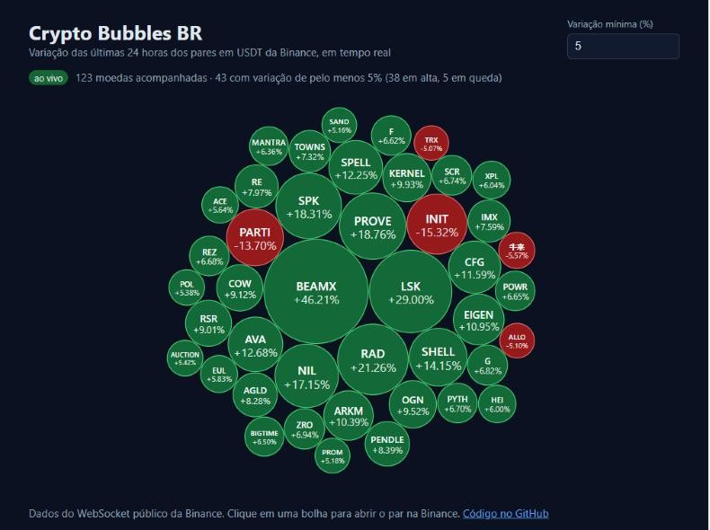

# Crypto Bubbles BR

[](https://github.com/rafaelholder/Crypto_Bubbles_BR/actions/workflows/deploy.yml)

Mostra em bolhas a variação das últimas 24 horas das criptomoedas negociadas em USDT na Binance, atualizada em tempo real por WebSocket. Cada bolha cresce com o tamanho da variação e fica verde na alta ou vermelha na queda. Inspirado no [Crypto Bubbles](https://cryptobubbles.net).

**Demo:** https://rafaelholder.github.io/Crypto_Bubbles_BR/

<p align="center">
  
</p>

## Funcionalidades

- Dados ao vivo do stream público `!miniTicker@arr` da Binance, com reconexão automática se a conexão cair
- Filtro de variação mínima (%) para mostrar só os movimentos relevantes
- Resumo com o total de moedas acompanhadas e quantas estão em alta ou em queda
- Clique numa bolha para abrir o par na Binance
- Layout responsivo, no computador e no celular

## Como funciona

1. O hook [`useVariacoesBinance`](src/hooks/useVariacoesBinance.js) abre o WebSocket e fecha a conexão quando a página é desmontada.
2. O stream só envia as moedas que mudaram no último segundo, então [`atualizarVariacoes`](src/utils/market.js) acumula um mapa moeda → variação. Ele descarta pares que não são em USDT e tokens alavancados (`BTCUPUSDT`, `ETHDOWNUSDT`...).
3. [`filtrarBolhas`](src/utils/market.js) aplica a variação mínima e ordena as moedas.
4. [`BubbleChart`](src/components/BubbleChart.js) calcula o layout com o `pack` do `d3-hierarchy` e desenha as bolhas em SVG com React.

## Tecnologias

- Next.js 16 (exportação estática) e React 19
- d3-hierarchy
- Vitest
- GitHub Actions e GitHub Pages

## Como rodar

```bash
git clone https://github.com/rafaelholder/Crypto_Bubbles_BR.git
cd Crypto_Bubbles_BR
npm install
npm run dev
```

Abra http://localhost:3000 no navegador.

## Testes

```bash
npm test
```

Os testes cobrem o cálculo da variação, os filtros de pares e a ordenação das bolhas. A cada push na `main`, o GitHub Actions roda os testes, gera o site estático e publica no GitHub Pages.
